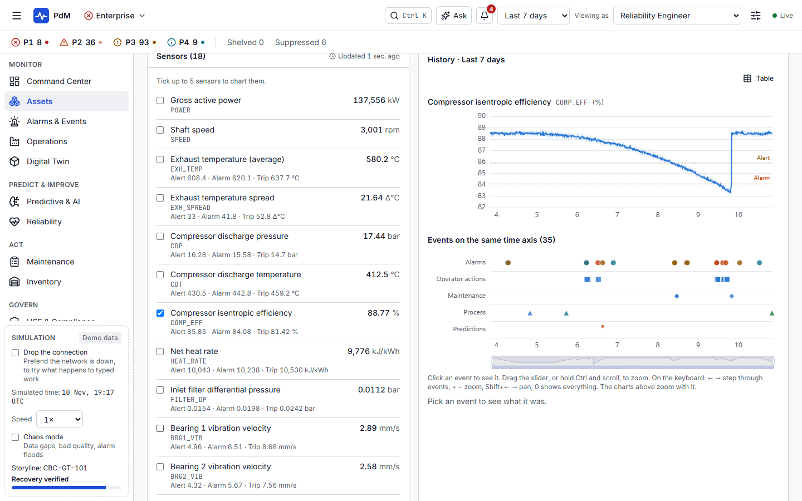
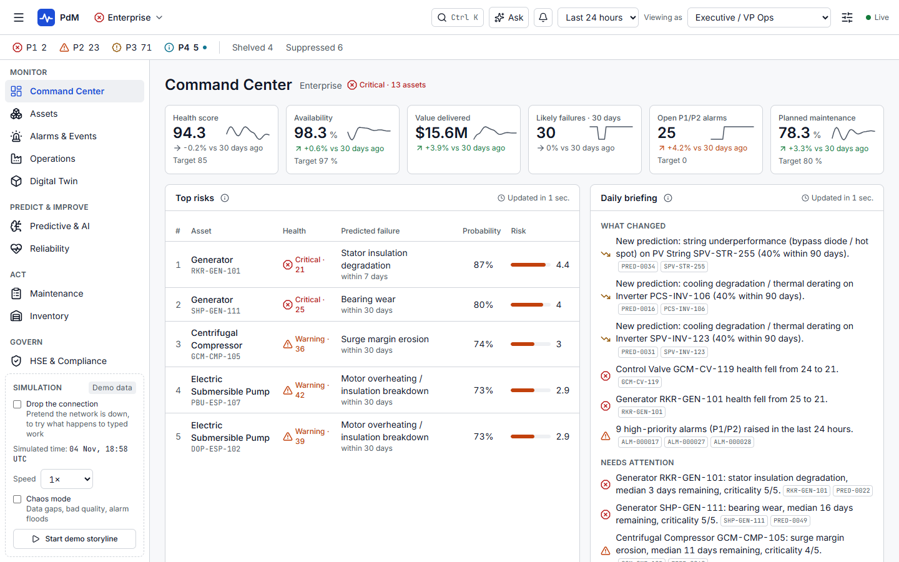
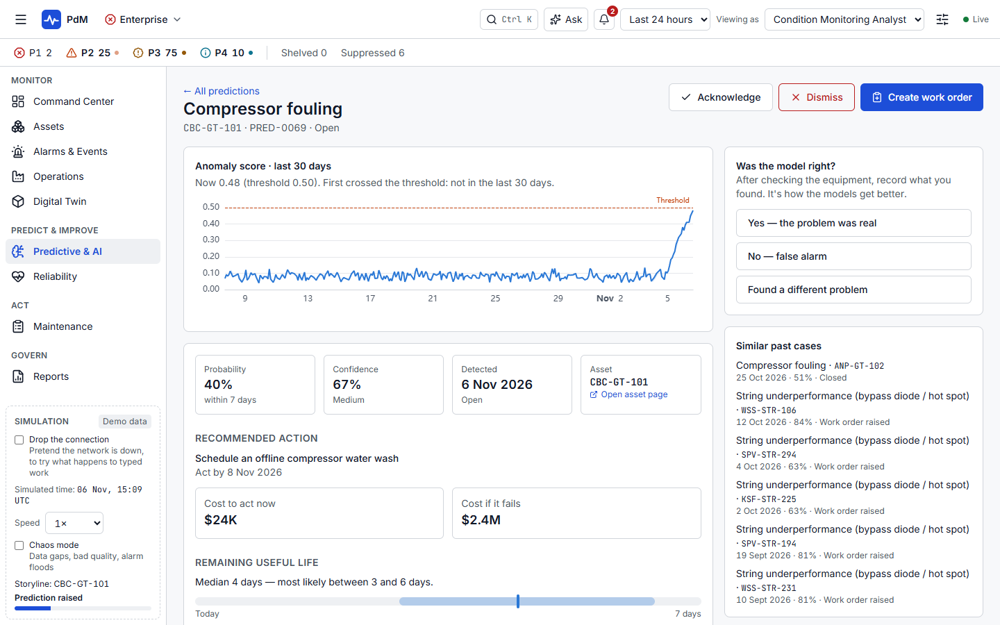
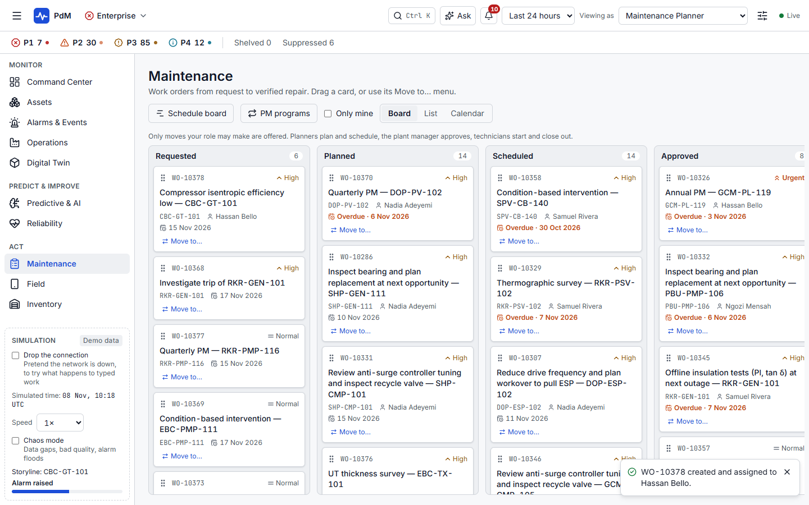
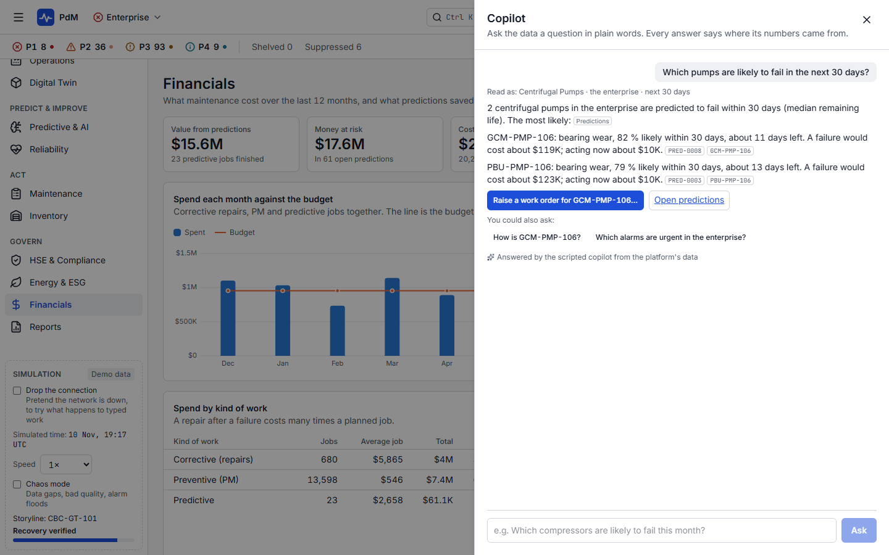
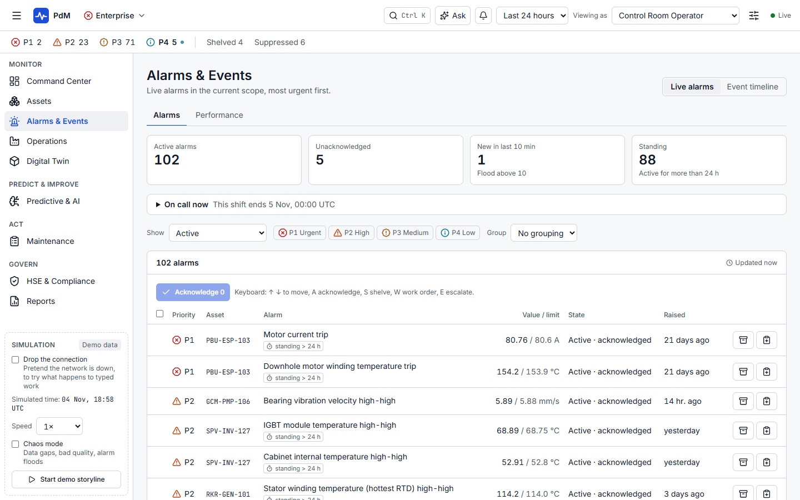
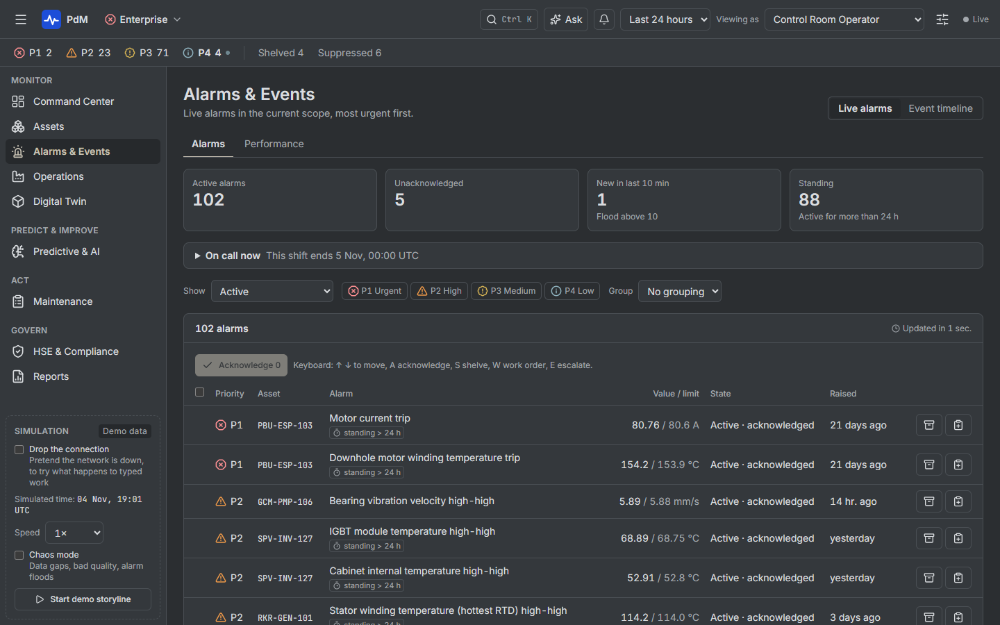

# PdM: a predictive maintenance platform

[](https://github.com/Abdulhafeez-Abdulsalam/PdM/actions/workflows/ci.yml)

A web application for an energy company working in **oil & gas**, **gas-to-power** and **solar**. It watches the equipment (pumps, compressors, gas turbines, transformers, solar inverters, pipelines), spots the ones heading for failure before they fail, and organises the maintenance to fix them.

It runs **entirely in your browser** on a simulated plant: no server, account or real data needed. The same app can also run against a real server with sign-in, role checks and a database.

## What you can do in it

- **See the whole company at a glance**: health, risks and money at stake on the Command Center, down to any site, area, unit or asset.
- **Catch failures early**: predictions with their evidence and the remaining useful life, anomalies across the fleet, vibration spectra, waterfalls and orbits.
- **Be told what needs you**: a notification bell with what matters to your role, from urgent alarms to the jobs assigned to you.
- **Handle alarms properly**: a live alarm list following ISA-18.2 (acknowledge, shelve, suppress), alarm-flood warnings, on-call rosters with automatic escalation, and every event on one time axis with the sensor charts.
- **Turn a warning into a repair**: an alarm becomes an assigned work order in two clicks, through planning, scheduling and a field technician's safety-checked job, which keeps what was typed even when the connection drops.
- **Learn from failures**: reliability KPIs (MTBF, MTTR), Weibull analysis, a risk matrix, FMEA and root-cause analysis.
- **Run the rest of maintenance**: PM programmes, spare parts, permits and incidents, emissions, costs, reports and shift handovers, data quality, and administration.
- **Ask**: a copilot answers questions about the plant from its own data, citing where each answer came from, within what your role may see.

Eleven roles, from executive to field technician, each with their own home page and only the actions their role allows. Three themes: light, dark, and a low-glare **control room** theme. Every screen works with the keyboard and at phone width.

## See it

**Everything on one time axis.** A gas turbine's compressor efficiency falls through its limits, a water wash brings it back, and the alarms, work orders, predictions and repair line up underneath:



| | |
| --- | --- |
|  **The Command Center:** health, top risks and the daily briefing |  **A prediction:** what's likely, when, and the cost of acting against the cost of failing |
|  **The maintenance board:** work orders from request to verified repair |  **The copilot:** answers with their sources |
|  **Live alarms**, following ISA-18.2 |  **The control room theme:** low glare for dark rooms |

These are taken automatically by the [demo walkthrough](docs/demo-walkthrough.md)'s test.

## Run it

You need **Node.js 24** (the version the CI tests on) and npm.

```bash
npm install      # download everything (also installs the git hooks)
npm run dev      # start the app → open http://localhost:5173
```

That's demo mode: the simulated plant runs inside your browser. Use the **Simulation** panel at the bottom of the left menu to speed up time, cause trouble (a dropped connection, bad data), or start the **demo storyline**, which follows one fault from its first warning to a verified repair. **Viewing as** at the top switches between roles.

### With the server

The same app, talking to a real server: you sign in as one of the demo people, the server checks every request against that person's role, live values arrive over a WebSocket, and what people do is kept in a SQLite database that survives a restart.

```bash
npm start               # build the app and start the server → open http://127.0.0.1:4000
```

To work on it, use two terminals; both reload when you change a file:

```bash
npm run dev:server      # the API on http://127.0.0.1:4000
npm run dev:connected   # the app in server mode → open http://localhost:5173
```

Settings are environment variables, checked at start-up (a wrong one stops the server and says which):

| Variable | Default | What it's for |
| --- | --- | --- |
| `PORT` | `4000` | Where the server listens |
| `HOST` | `127.0.0.1` | Which network address; the default means only this computer can connect |
| `DB_FILE` | `apps/server/data/pdm.sqlite` | The database file. Stop the server and delete it to start afresh |
| `SEED` | `20261010` | Which simulated plant, for a new database |
| `WEB_DIST` | `apps/web/dist-server` | The built app to serve (built by `npm start`) |
| `LOG_LEVEL` | `info` | How much to log: `error`, `warn`, `info`, `debug`… |
| `COOKIE_SECURE` | `false` | Set to `true` when the site is served over HTTPS |
| `SIGN_IN_ATTEMPTS_PER_MINUTE` | `10` | Sign-ins allowed from one address per minute |

`http://127.0.0.1:4000/api/health` says whether it's up. Logs are one JSON line per event. Ctrl+C stops it cleanly.

**It isn't ready for the internet as it is**: it would still need HTTPS, real accounts instead of demo sign-in, database backups and monitoring ([ADR-0017](docs/adr/0017-running-the-server.md)).

## Tests and checks

| Command | What it checks | Time |
| --- | --- | --- |
| `npm run check` | Formatting, types, lint, and every package's unit tests (about 590). Run before every commit | ~10 min |
| `npm run e2e` | The demo app in Chrome: journeys, accessibility (axe) on every screen in every theme, phone width, printing, performance | ~20 min |
| `npm run e2e:server` | The main journeys against the real server, with a fresh database | ~1 min |
| `npm run demo:screenshots` | Acts out the [demo walkthrough](docs/demo-walkthrough.md) and retakes the screenshots above | ~3 min |
| `npm run storybook` | Opens the component catalogue on http://localhost:6006: every shared component in each state and theme | |
| `npm run test:stories` | Every story in every theme: axe, and a comparison with its saved screenshot | ~5 min |

GitHub runs `check`, `e2e:server` and the catalogue's accessibility checks on every push, and the full demo-mode suite every Monday ([ADR-0018](docs/adr/0018-ci-on-github-actions.md)). The browser tests use your installed Google Chrome.

## How it's built

React and TypeScript, built with Vite; TanStack Router, Query and Virtual; Tailwind CSS on design tokens; ECharts for charts; Zod for every data shape. The server is Fastify on Node.js with its built-in SQLite. An npm workspaces monorepo, run with Turborepo.

| Folder | What's inside |
| --- | --- |
| `apps/web` | The application |
| `apps/server` | The server: every request over HTTP, live values over a WebSocket, sign-in, the database |
| `apps/catalogue` | Storybook: the component catalogue and its checks |
| `packages/contracts` | Every data shape and request, shared by the app, the simulation and the server |
| `packages/api-client` | How the app asks for data and receives live updates, from either backend |
| `packages/mock-data` | The simulated plant and backend (in a Web Worker in demo mode, inside the server otherwise) |
| `packages/ui` | Design tokens, the three themes and shared components |
| `packages/charts` | Chart components, coloured from the design tokens |

## Read more

- **[The demo walkthrough](docs/demo-walkthrough.md)**: a 15–20 minute script following one fault from its first warning to a verified repair.
- **[The documentation index](docs/README.md)**: architecture, design system, pages and roles, data contracts, the simulation, decisions, plans and reviews.
- **[55 learning notes](docs/README.md#learning-notes)**: the ideas behind each part, in plain language, with exercises. This project was built step by step as a way to learn full-stack development.
- **[What changed from the original brief, and why](docs/scope-decisions.md)**.

## Contributing

See **[CONTRIBUTING.md](CONTRIBUTING.md)**: how to set up, the checks, commit messages, and the rules the code follows.

## Licence

[MIT](LICENSE) © 2026 Abdulhafeez Abdulsalam. The plant, the people and the data in it are made up.
