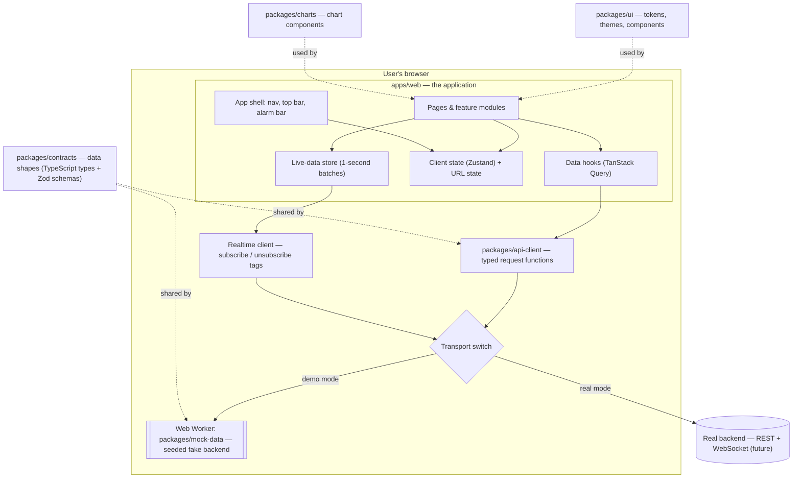

# Deliverable 1 — Architecture Overview

## In plain words first

A web app has two halves:

- The **frontend** is what runs in the user's browser: the screens, buttons, charts.
- The **backend** is a server somewhere else that stores data and does heavy work. The frontend asks it for data over the internet using an **API** (a defined set of "requests you're allowed to make").

**This project builds the frontend only.** There is no real backend yet, so we build a **fake backend** (the "mock") that lives inside the browser and answers the same requests a real one would. Later, a real backend can replace it, and the screens won't need to change. That swap point is the most important idea in this architecture.

```
   What the user sees          How it gets data             Where data comes from
 ┌──────────────────┐      ┌───────────────────┐      ┌──────────────────────────────┐
 │ Pages & charts   │ ───▶ │ API client        │ ───▶ │ TODAY: mock (fake) backend   │
 │ (React)          │ ◀─── │ (one switch point)│ ◀─── │ LATER: real backend server   │
 └──────────────────┘      └───────────────────┘      └──────────────────────────────┘
```

---

## 1. System diagram



### How a request flows (example: opening an asset page)

1. The user goes to `/assets/GT-101`.
2. The **router** shows the Asset 360 page.
3. The page calls a hook: `useAsset("GT-101")`.
4. The hook (TanStack Query) checks its **cache**. If the data is fresh, it is shown instantly; if not, it calls `api.assets.get("GT-101")`.
5. The **API client** hands the request to the **transport**.
6. In demo mode, the transport sends a message to the **Web Worker** running the fake backend. In real mode, it would call `https://…/api/assets/GT-101`.
7. The answer comes back, is **checked against the contract** (Zod schema), cached, and drawn on screen.

### How live data flows

1. The Asset 360 "Live Telemetry" tab says: "I need tags `GT-101.EXH_TEMP`, `GT-101.VIB_X`, …".
2. The **realtime client** adds them to a reference-counted subscription list (if two widgets want the same tag, it is only subscribed once).
3. The worker sends new values **once per second**, only for subscribed tags.
4. Values land in the **live-data store**. Components re-draw only if *their* tags changed.
5. Leaving the page unsubscribes. Data stops.

Budgets (from [ADR-0005](../adr/0005-live-data-budget.md)): **≤ 300 subscribed tags**, **≤ 1 update per tag per second**, **1 screen update per second**.

### How chart history flows

1. A chart asks for `GT-101.EXH_TEMP` over the last 7 days.
2. The API client sends `from`, `to`, and `maxPoints = 2000`.
3. The data service picks an interval so the answer has ≤ 2,000 points — for 7 days that is **10 minutes** → 1,008 points.
4. Each point carries **average, minimum and maximum** for its interval. The chart draws the average as a line and min/max as a faint band, so short spikes stay visible even when averaged.

Full table in [ADR-0006](../adr/0006-chart-point-budget.md).

---

## 2. Technology decisions

Each row has a full **Architecture Decision Record (ADR)** in [docs/adr/](../adr/) explaining options considered and trade-offs.

| Concern | Choice | Why (short) | ADR |
|---|---|---|---|
| Language | **TypeScript** (strict mode) | Catches mistakes before the code runs; the editor can autocomplete data shapes | — |
| UI library | **React** | Most widely used; huge ecosystem; required by spec | — |
| Build tool / dev server | **Vite** | Very fast; simple; produces static files any web server can host | [0001](../adr/0001-vite-spa.md) |
| Routing (URLs → pages) | **TanStack Router** | Type-safe URLs and type-safe filter parameters in the URL (shareable links) | [0001](../adr/0001-vite-spa.md) |
| Repo layout | **Monorepo**: npm workspaces + Turborepo | Several packages in one repo, built and tested together | [0002](../adr/0002-monorepo.md) |
| Server data (fetching, caching) | **TanStack Query** | Handles loading/error states, caching, refetching for us | — |
| Client state (theme, units, role…) | **Zustand** | Tiny and simple compared to Redux | — |
| Shareable state (filters, time range) | **URL search parameters** | Copy the link → colleague sees the same view | — |
| Styling | **Tailwind CSS** + **CSS variables** for tokens | Fast to write; themes swap by changing variables | [Design system](../02-design-system/README.md) |
| Accessible building blocks | **Radix UI** primitives (via **shadcn/ui** patterns) | Dialogs, menus, tabs that already handle keyboard and screen readers | — |
| Charts | **ECharts** | Free, fast, many chart types incl. heatmaps and custom series | [0003](../adr/0003-open-source-charts-and-maps.md) |
| Custom visuals | **D3** (Phase 3) | Sankey, radial health, P&ID overlays | — |
| Maps | **MapLibre GL** + **deck.gl** | Free; no access token; handles thousands of markers | [0003](../adr/0003-open-source-charts-and-maps.md) |
| 3D | **react-three-fiber** (Phase 3) | React wrapper around Three.js | — |
| Tables | **TanStack Table** + **TanStack Virtual** | Sorting, grouping, pinning; virtualization draws only visible rows | — |
| Forms | **React Hook Form** + **Zod** | Fast forms; one schema does both typing and validation | — |
| Command palette | **cmdk** | Ctrl/Cmd+K search box | — |
| Drag-and-drop | **dnd-kit** (Kanban), **react-grid-layout** (dashboards) | Accessible drag-and-drop | — |
| Text catalog | **i18next** (English only) | All text in one file; languages can be added later | [0009](../adr/0009-english-only-text-catalog.md) |
| Fake backend | Custom seeded generator in a **Web Worker** | Same requests as a real backend; runs off the main thread | [0004](../adr/0004-mock-backend-in-web-worker.md) |
| Unit tests | **Vitest** + **React Testing Library** | Fast; tests from the user's point of view | — |
| End-to-end tests | **Playwright** (+ screenshot comparison) | Drives a real browser through real user journeys | — |
| Component catalogue | **Storybook** | Every component shown in every state | — |
| Accessibility checks | **axe-core** (in Vitest, Playwright, Storybook) | Automated WCAG checks | — |
| Code quality | ESLint, Prettier, Husky, Conventional Commits | Consistent style; checks run before each commit | — |

**Removed from the spec's stack:** Next.js, PWA/service worker/offline storage, RTL tooling, Highcharts, Mapbox, Chromatic. See [scope-decisions.md](../scope-decisions.md).

**Versions:** latest stable releases at the time of setup, pinned in `package-lock.json`. We'll check that every library supports the chosen React version before installing.

---

## 3. Folder structure

```
PdM/
├─ apps/
│  └─ web/                      ← the application users open in a browser
│     ├─ index.html
│     ├─ public/                ← static files (logo, map styles)
│     ├─ e2e/                   ← Playwright end-to-end tests
│     └─ src/
│        ├─ main.tsx            ← starting point: mounts React into the page
│        ├─ app/                ← app-wide wiring
│        │  ├─ providers.tsx    ←   query cache, theme, text catalog
│        │  ├─ router.tsx
│        │  └─ shell/           ←   left nav, top bar, alarm bar, side panel
│        ├─ routes/             ← one file per URL (TanStack Router)
│        ├─ features/           ← one folder per module
│        │  ├─ command-center/
│        │  ├─ assets/
│        │  ├─ alarms/
│        │  └─ …
│        ├─ shared/             ← helpers used by many features
│        │  ├─ roles/           ←   role definitions + canSee / canDo
│        │  ├─ units/           ←   SI / Imperial / Oilfield conversion
│        │  ├─ time/            ←   time ranges, time zones
│        │  └─ text/            ←   English text catalog
│        └─ styles/
│
├─ packages/
│  ├─ contracts/    ← data shapes: TypeScript types + Zod schemas (Asset, Alarm, Tag…)
│  ├─ api-client/   ← typed request functions, query hooks, transport switch, realtime client
│  ├─ mock-data/    ← seeded fake backend that runs in a Web Worker
│  ├─ ui/           ← design tokens, 3 themes, components, Storybook
│  ├─ charts/       ← ECharts-based chart components (TimeSeriesChart, RiskMatrix…)
│  └─ config/       ← shared TypeScript / ESLint / Prettier / Vitest settings
│
├─ docs/            ← you are here
├─ package.json     ← root: workspace list + scripts
├─ turbo.json       ← build/test pipeline
└─ tsconfig.base.json
```

### Inside one feature folder

```
features/alarms/
├─ components/      AlarmTable.tsx, ShelveDialog.tsx      ← what you see
├─ hooks/           useAlarmActions.ts                    ← connects UI to data
├─ model/           alarm-grouping.ts                     ← pure logic, no React (easy to test)
├─ alarms.test.ts                                         ← tests sit next to the code
└─ index.ts                                               ← the only file other features may import
```

### Dependency rules (who may import whom)

Arrows mean "may import from". Anything not shown is forbidden and checked by ESLint.

```
contracts  ←  api-client  ←  apps/web
contracts  ←  mock-data   ←  apps/web (loaded only in demo mode)
ui         ←  charts      ←  apps/web
```

- `contracts` depends on nothing of ours. It is the shared language between the frontend and any backend.
- `ui` knows nothing about energy, assets, or APIs. It could be reused in another product.
- Features import other features **only through their `index.ts`**.
- `mock-data` is loaded with a dynamic import in demo mode, so it never ships in a real-backend build.

---

## 4. Cross-cutting design

| Topic | Approach |
|---|---|
| **Error isolation** | Every dashboard widget is wrapped in its own **error boundary**. One broken chart shows "This widget failed — Retry"; the rest of the page keeps working. |
| **Stale data** | Every widget shows a freshness badge ("updated 12 s ago"). Live values older than 10 s are greyed and marked *stale*. |
| **Connection loss** | A banner appears. Live values freeze and are marked stale. Form input is kept in memory until it can be sent (see [ADR-0007](../adr/0007-online-only.md)). |
| **Role-based views** | One config file lists what each role sees. `canSee(module)` hides menu items and pages; `canDo(action)` hides buttons. Not a security boundary — see [ADR-0008](../adr/0008-simple-role-based-views.md). |
| **Units** | Data is stored internally in SI units and converted only when displayed. |
| **Time** | Data is stored in UTC. Shown in site time, UTC, or the user's time (user's choice). |
| **Text** | No text typed directly into components; everything goes through the text catalog. |
| **Colours** | No colour values in components; everything goes through design tokens. |
| **Performance** | Each page loads its code only when visited (code-splitting). Lists of 100+ rows are virtualized. |
| **Observability** | Hooks for error reporting (Sentry-style), Web Vitals and API timings, logging to the console in development. |
| **Security (frontend share)** | Content Security Policy, no secrets in the client code, dependency scanning in CI. Real access control belongs to the backend. |

---

## 5. Assumptions

1. Users have a modern browser (latest two versions of Chrome, Edge, Firefox, Safari).
2. Users have a working internet connection (offline mode is out of scope).
3. A future real backend will follow the contracts in `packages/contracts`. If it differs, only the API client changes.
4. Demo data is fictional but physically plausible. Numbers are not taken from any real company.
5. Screens from 360 px (phone) to 4K wall displays are supported; the main target is a 1920 × 1080 desktop.

## 6. Trade-offs we accepted

| We chose | We gave up | Why it's worth it |
|---|---|---|
| Vite single-page app | Server rendering, faster very first load | Everything is behind a login; simpler hosting and mental model |
| 1 update/second | Sub-second live data | People can't read faster; machines stay smooth |
| 2,000 points per line | Raw full-resolution long ranges | Zooming in recovers the detail; min/max band keeps spikes visible |
| Online-only | Field work with no signal | Removes the hardest problem in the spec |
| Role views without security | — (security was never possible in the frontend) | Honest about where security lives |
| Monorepo with 6 packages | More setup at the start | Clean boundaries as the code grows large |

## 7. Revised delivery plan

| Step | Content |
|---|---|
| 1–3 | Architecture, design system, information architecture ← **this stage** |
| 4 | Data contracts: types, API endpoint list, live message formats |
| 5 | Mock data engine |
| 6 | **Phase 1:** shell, role views, design system, asset hierarchy, Command Center, Asset 360, Alarms |
| 7 | Phase 2: prediction console, anomaly views, explainability, work orders, field technician screens (online) |
| 8 | Phase 3: oil & gas, gas-to-power, solar views; reliability suite; digital twin |
| 9 | Phase 4: inventory, HSE, ESG, financials, reports, admin, integrations, AI copilot |
| 10 | Testing & quality, documentation, demo walkthrough script |
